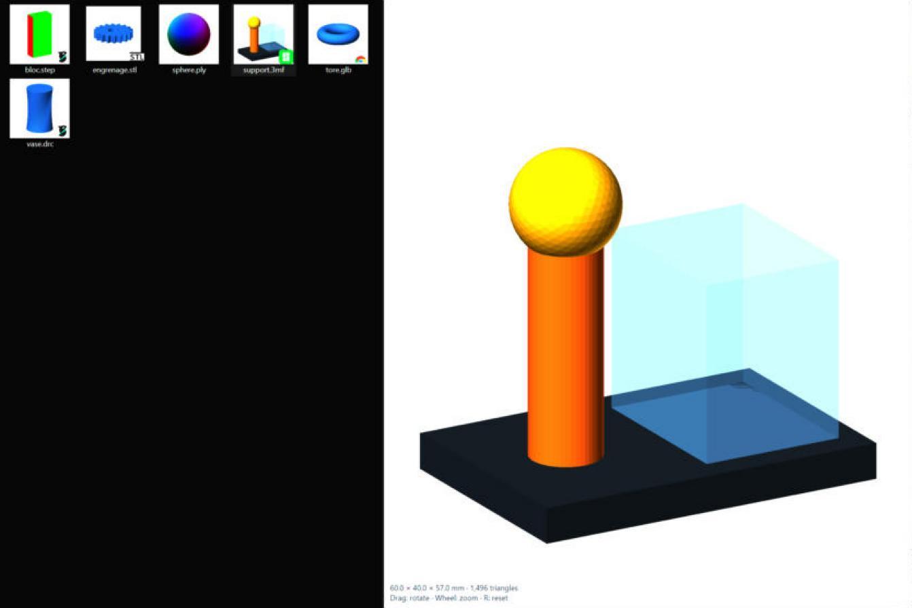

# explorer-draco-step-preview

*[English version](README.en.md)*

Miniatures et aperçu 3D des fichiers **Draco** (`.drc`), **STEP** (`.step`, `.stp`), **STL**, **OBJ**, **3MF**, **PLY**, **GLB/GLTF** et **AMF** directement dans l'Explorateur Windows : icônes du dossier et volet d'aperçu (Alt+P), où le modèle se tourne à la souris.



- **Draco** : toutes les faces sont dessinées par OpenGL, Z vers le haut comme dans un trancheur.
- **STEP** : lecture par OpenCascade, avec les couleurs des pièces et des faces ; les vitrages (polycarbonate, verre…) sont translucides. Testé jusqu'à un assemblage de 142 Mo (Rat Rig V-Core 4.1, 790 pièces).
- **STL, OBJ, 3MF** : couleurs des faces (STL binaires VisCAM et Magics), des sommets (OBJ) et des matériaux (3MF) ; STL texte ou binaire, même tronqués ; projets 3MF à plusieurs pièces. Remplace les miniatures STL de PowerToys et le gestionnaire 3MF de Windows, remis en place au retrait.
- **Projets de trancheurs** : couleurs des filaments de Bambu Studio, OrcaSlicer et PrusaSlicer, par objet, par pièce et en peinture multicolore.
- **Dimensions** : encombrement en millimètres et nombre de triangles en bas du volet d'aperçu.
- **Miniatures à jour** : clic droit sur un dossier, « Refaire les miniatures 3D » (« Afficher plus d'options » sous Windows 11).
- **Isolé** : chaque aperçu tourne dans un processus séparé, à faible intégrité, limité en mémoire et en temps. Un fichier piégé ou trop gros ne peut pas bloquer l'Explorateur.
- **Réversible** : installation par utilisateur, sans droits d'administrateur. Le programme d'ouverture par défaut n'est jamais modifié, et le retrait remet le registre exactement comme avant.

Projet né à côté de [dracoconv](https://github.com/DrFreeman001/dracoconv), le convertisseur Draco pour collections de modèles d'impression 3D.

## Installation

**Le plus simple :** téléchargez `explorer-draco-step-preview-<version>-setup.exe` dans les [versions publiées](https://github.com/DrFreeman001/explorer-draco-step-preview/releases/latest) et lancez-le (environ 56 Mo, rien d'autre à installer : Python et OpenCascade sont inclus). Installation pour vous seul, sans droits d'administrateur ; désinstallation depuis « Applications installées », qui remet le registre comme avant. L'installateur n'étant pas signé, Windows SmartScreen peut afficher « éditeur inconnu » : « Informations complémentaires », puis « Exécuter quand même ».

**Depuis les sources :** Windows 10 ou 11 x64, Python 3.11 ou plus récent, outils de compilation Microsoft C++ (Visual Studio Build Tools, charge « Développement Desktop en C++ »). Depuis PowerShell :

```powershell
git clone https://github.com/DrFreeman001/explorer-draco-step-preview.git
cd explorer-draco-step-preview
py -m venv .venv
.venv\Scripts\python -m pip install -e .
.venv\Scripts\python windows\preview\configure.py
python -I windows\preview\fetch_occt.py     # une fois, pour STEP : OpenCascade (environ 140 Mo) dans third_party
.\windows\preview\build.ps1
.venv\Scripts\python windows\preview\register.py install
```

Puis redémarrez l'Explorateur, ou fermez votre session. Sans `fetch_occt.py`, seuls les fichiers `.drc` sont pris en charge.

Retrait :

```powershell
.venv\Scripts\python windows\preview\register.py uninstall
```

Pour fabriquer l'installateur (Inno Setup 6 nécessaire) : `.\windows\installer\build_installer.ps1`.

Gardez le dossier en place tant que l'extension est installée : le registre pointe vers lui, et `windows\preview\build\registration.json` sert au retrait exact.

## Limites

- Fichiers de 64 Mo au plus pour un Draco, 200 Mo pour les autres formats ; 90 s et 3 Go de mémoire par aperçu.
- Un seul aperçu ouvert à la fois ; une seconde fenêtre l'indique.
- Le clavier ne fonctionne qu'après un clic dans le modèle (R pour réinitialiser la vue).
- Un gros STEP met du temps : environ 50 s pour 142 Mo. Son maillage est gardé une heure au plus pour que miniature et aperçu ne le lisent pas deux fois.
- Si « 3D Viewer » de Microsoft est installé, c'est lui qui occupe le volet d'aperçu des STL, OBJ et 3MF : une application du Store passe avant les réglages du registre. Les miniatures restent les nôtres. Pour avoir aussi l'aperçu, désinstallez 3D Viewer (Microsoft ne le développe plus) depuis « Applications installées ».
- Les miniatures déjà en cache ne sont pas refaites : Windows les garde jusqu'à ce que le fichier change ou que le cache soit vidé (Nettoyage de disque → Miniatures).

Détails techniques : [windows/preview/README.md](windows/preview/README.md). Mesures et essais : [windows/preview/verification.md](windows/preview/verification.md).

## Licence

Apache-2.0. Composants tiers : [THIRD-PARTY-NOTICES.md](THIRD-PARTY-NOTICES.md).
